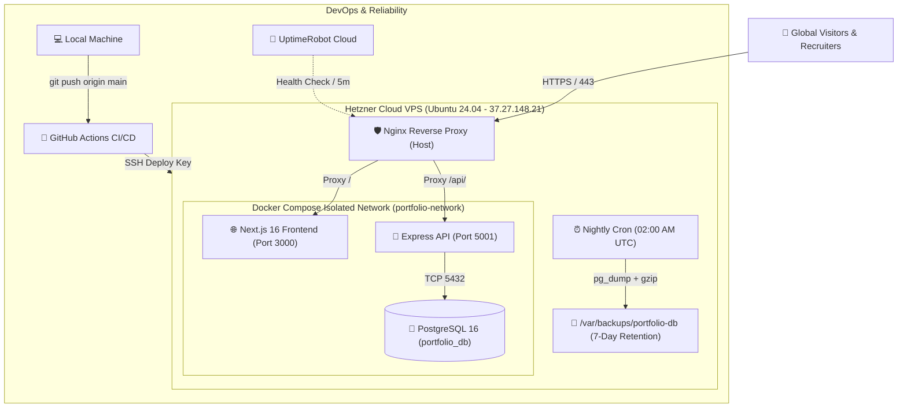

# ⚡ Tharusha Sangeeth — Developer Portfolio & DevOps Platform

<div align="center">

[](https://github.com/Tharusha2002-s/my-portfolio/actions/workflows/ci.yml)
[](https://tharushasangeeth.live)
[](https://tharushasangeeth.live/api/health)
[](https://nextjs.org/)
[](https://www.docker.com/)
[](LICENSE)

**A high-performance, containerized developer portfolio and production-grade cloud platform showcasing Full-Stack Engineering, AI/ML development with Python, and an automated end-to-end DevOps lifecycle.**

[🌐 Explore Live Production](https://tharushasangeeth.live) • [🚀 View Health Endpoint](https://tharushasangeeth.live/api/health) • [📁 Source Code](https://github.com/Tharusha2002-s/my-portfolio)

</div>

---

## 🏛️ System Architecture

This project is built as a production-grade, multi-tier cloud application running on a **Hetzner Cloud VPS (Ubuntu 24.04)** behind an **Nginx Reverse Proxy** with automated **SSL/TLS encryption**, orchestrated via **Docker Compose**, and deployed continuously via **GitHub Actions**.



---

## ✨ Features

- **🎨 Modern Dark Aesthetic**: Engineered with sleek glassmorphism, glowing cyan accents (`#00c8ff`), smooth micro-interactions, and responsive layout across mobile (360px+), tablet, and desktop.
- **⚡ Command Palette (`Ctrl + K`)**: Rapid keyboard-accessible navigation and quick project switching.
- **🛠️ AI/ML & Python Focus**: Showcasing full-stack scalable web architecture alongside ongoing engineering in Artificial Intelligence and Machine Learning.
- **📂 Real-World Projects**: Detailed showcases including:
  - **TitanCore ERP**: Industrial management and production tracking system.
  - **RoadAware**: AI/ML computer vision system for road safety and hazard detection.
- **🔒 Protected Admin Panel**: Authenticated portal (`/admin`) for managing live projects, editing skills, and viewing visitor messages.
- **📬 Contact API**: Interactive contact form with input validation and persistent PostgreSQL storage.
- **📄 Dedicated Resume & Blog**: Comprehensive career timeline, downloadable CV, and technical articles.

---

## 🛠️ Technology Stack

| Layer | Technologies |
| :--- | :--- |
| **Frontend** | **Next.js 16** (App Router, Turbopack, Standalone Output), **React 19**, **TypeScript**, **TailwindCSS** |
| **Backend** | **Node.js 22**, **Express.js**, **TypeScript**, **Prisma ORM** |
| **Database** | **PostgreSQL 16** (Docker containerized with persistent named volume) |
| **Containerization** | **Docker Engine**, **Multi-stage Dockerfiles**, **Docker Compose** |
| **Cloud Hosting** | **Hetzner Cloud VPS** (Ubuntu 24.04 LTS, Falkenstein/Nuremberg Datacenter) |
| **Web Server & SSL** | **Nginx** (Host Reverse Proxy), **Certbot / Let's Encrypt** (Auto-renewing TLS/SSL) |
| **CI/CD Pipeline** | **GitHub Actions** (Automated linting, TypeScript build, Docker buildx, SSH deployment) |
| **Disaster Recovery** | Bash automated `pg_dump` with gzip compression, cron scheduling & 7-day retention |
| **Monitoring & Logs** | **UptimeRobot** (24/7 global pings), Docker `json-file` log rotation (`max-size: 10m`) |

---

## ⚙️ DevOps Lifecycle Highlights

### 1. Multi-Stage Docker Containerization
- **Frontend** (`frontend/Dockerfile`): Utilizes a 3-stage build (`deps`, `builder`, `runner`). Produces a minimal Next.js Standalone container (~80MB) running as a non-privileged `nextjs` user.
- **Backend** (`backend/Dockerfile`): Multi-stage TypeScript build generating Prisma clients and running compiled JavaScript in production.
- **Docker Compose** (`docker-compose.yml`): Private bridge network, healthcheck dependencies (`pg_isready`), and volume persistence.

### 2. Automated Zero-Touch CI/CD Pipeline
Every push to `main` executes [.github/workflows/ci.yml](.github/workflows/ci.yml):
1. **Backend CI**: Validates Prisma schema, generates clients, and compiles TypeScript.
2. **Frontend CI**: Executes TypeScript type-checks (`tsc --noEmit`) and compiles Next.js with Turbopack.
3. **Docker Buildx**: Builds and validates backend & frontend container images in parallel.
4. **Automated Deployment (CD)**: Connects to the Hetzner VPS via an SSH `ed25519` deploy key:
   - Pulls latest commits (`git pull origin main`)
   - Rebuilds and restarts updated containers (`docker compose up -d --build`)
   - Prunes dangling Docker images (`docker image prune -f`)
   - Smoke tests the live site (`curl -I https://tharushasangeeth.live`)

### 3. Production Reliability & Operations (SRE)
- **Container Log Limits**: Configured `json-file` logging (`max-size: "10m"`, `max-file: "3"`) across all services to prevent disk exhaustion.
- **Automated Database Backups**: Nightly cron job (`scripts/backup-db.sh`) running at `02:00 AM UTC` compressing dumps and auto-purging backups older than 7 days.
- **One-Command Restoration**: Emergency disaster recovery script (`scripts/restore-db.sh`) to restore any snapshot in seconds.
- **24/7 Uptime Monitoring**: External cloud monitor pinging `/api/health` every 5 minutes with instant email alerting.

---

## 🚀 Local Development Setup

### Prerequisites
- [Node.js 22+](https://nodejs.org/)
- [Docker & Docker Compose](https://www.docker.com/)
- [Git](https://git-scm.com/)

### 1. Clone Repository
```bash
git clone https://github.com/Tharusha2002-s/my-portfolio.git
cd my-portfolio
```

### 2. Environment Variables
Create `.env` file in the root based on [.env.docker.example](.env.docker.example):
```bash
cp .env.docker.example .env
```

### 3. Run with Docker Compose (Recommended)
```bash
# Build and launch all services (Frontend, Backend, PostgreSQL)
docker compose up -d --build

# View logs
docker compose logs -f

# Stop containers
docker compose down
```
The application will be available at:
- **Frontend**: `http://localhost:3000`
- **Backend API**: `http://localhost:5001/api`
- **Health Check**: `http://localhost:5001/api/health`

---

### Manual Development Setup (Without Docker)

#### Backend Setup:
```bash
cd backend
npm install
npx prisma generate
npx prisma db push
npm run dev
```

#### Frontend Setup:
```bash
cd frontend
npm install
npm run dev
```

---

## 💾 Disaster Recovery & Backup Scripts

### Run Manual Database Backup
```bash
chmod +x scripts/backup-db.sh
./scripts/backup-db.sh
# Output saved to /var/backups/portfolio-db/db_backup_YYYY-MM-DD_HHMMSS.sql.gz
```

### Restore Database from Backup
```bash
chmod +x scripts/restore-db.sh
./scripts/restore-db.sh /var/backups/portfolio-db/db_backup_2026-10-19_020000.sql.gz
```

---

## 👤 Author & Contact

**Tharusha Sangeeth**
- **Website**: [tharushasangeeth.live](https://tharushasangeeth.live)
- **LinkedIn**: [linkedin.com/in/tharusha-sangeeth-3b2665306](https://www.linkedin.com/in/tharusha-sangeeth-3b2665306/)
- **GitHub**: [@Tharusha2002-s](https://github.com/Tharusha2002-s)

---

## 📄 License
This project is licensed under the **ISC License**.
